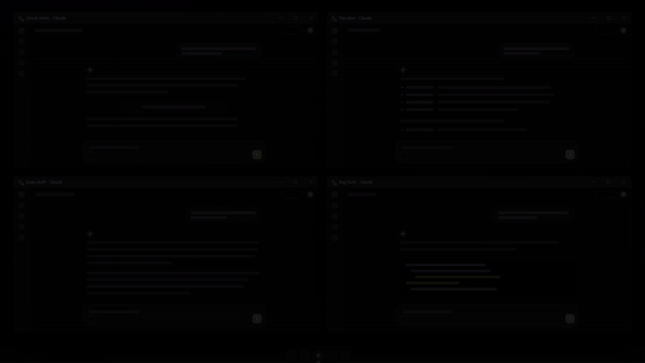

# Chroma for claude.ai

Chroma is a small, unofficial Chrome/Brave extension that recolors claude.ai so you can tell chats apart when you have several open. You give a chat its own accent color: claude.ai's highlights, the Claude logo and the tab icon turn that color, and a thin glow appears around the window. Each chat keeps its color across tabs, windows and reloads, and on other computers through browser sync. Chroma also adds darker and pure-black (AMOLED) backgrounds.

## Install

1. Download or clone this repo.
2. Open `chrome://extensions` (or `brave://extensions`) and turn on **Developer mode**.
3. Click **Load unpacked** and pick the folder.
4. Set claude.ai to dark mode and reload any open claude.ai tabs.

## Use

- **Pick a color**: hover the dot at the top right of claude.ai for quick colors, or click it for the full panel. Chats without a color stay Claude orange and don't glow.
- **Settings**: in the panel, the sliders icon opens the background, glow and other options.
- **Hotkeys**: `Alt+,` and `Alt+.` cycle colors; `Alt+Shift+P` opens the panel (Option on a Mac). The settings page lists the rest.
- **Sync**: colors follow you to other computers when browser sync has Extensions turned on.

Chroma isn't affiliated with Anthropic. It only changes how claude.ai looks in your browser and sends nothing anywhere. If a claude.ai update breaks it, [MAINTAINING.md](MAINTAINING.md) explains how it works and how to fix it.
